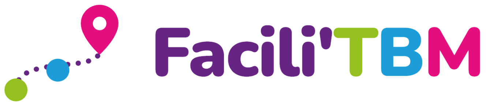

<p align="center">
  
</p>

<p align="center"><b>Le trajet en tram, préparé pour vous, puis guidé pas à pas.</b></p>

<p align="center">Hackathon Keolis × TBMouv Lab · Bordeaux · Défi #1 « Accessibilité et inclusion numérique »</p>

---

## Le défi

> Comment concevoir des outils numériques plus simples et plus rassurants pour aider les seniors à préparer et suivre leur trajet sur le réseau TBM ?

Pour beaucoup de seniors, le frein n'est pas physique : c'est l'**anxiété cognitive**. Ils ont peur de se tromper de direction, de rater leur arrêt ou de se perdre dans une correspondance. 60 % des seniors craignent d'être bousculés dans les transports (UTPF-IFOP, 2024) et 62 % des 75 ans et plus sont en difficulté avec le numérique (INSEE, 2023). Les applications existantes en disent trop, au mauvais moment.

## La solution

Facili'TBM s'appuie sur ce que TBM a déjà : **la ligne Allo TBM, le SMS et les données du réseau**.

1. **Un appel.** La personne appelle Allo TBM. Le conseiller suit un script de six questions (où, d'où, quel jour, quelle heure, marche possible, besoin d'accessibilité) et le portail calcule le trajet.
2. **Un SMS, un seul lien.** Le trajet arrive tout prêt sur le téléphone. Il n'y a rien à installer, rien à chercher et rien à taper.
3. **Un guidage, une consigne à la fois.** L'écran affiche en plein écran une seule consigne, et une voix la lit à haute voix :
   - « Marchez jusqu'à l'arrêt Hôtel de Ville »
   - « Attendez le tram A, direction Mérignac Centre »
   - « Restez dans le tram, je vous préviens »
   - « Prochain arrêt : descendez »

   L'application n'affiche ni minutes, ni distances, ni compteur d'étapes. Le bouton **Aide** est toujours visible : il permet d'appeler un proche ou un agent TBM, ou de demander « Où suis-je ? ».

### Principes de conception

- **Une seule consigne à l'écran.** Les seniors n'ont pas besoin des temps et des distances : ils ont besoin de savoir quoi faire maintenant.
- **Rassurer plutôt qu'informer.** Une voix calme, des vibrations aux moments clés et un écran qui passe en orange juste avant de descendre.
- **Pas de stigmatisation.** L'application n'a pas de « mode senior » : c'est simplement un trajet bien préparé.
- **Accessible par défaut.** Polices lisibles (Atkinson Hyperlegible, Lexend), grandes zones tactiles, forts contrastes et libellés pour les lecteurs d'écran.

## Contenu du dépôt

| Dossier | Contenu |
|---|---|
| [`demo/`](demo) | Application de démonstration (Nuxt 4, Tailwind 4, MapLibre, motion-v) : l'appli voyageur et le portail conseiller Allo TBM |
| [`pitch/`](pitch) | Vidéo de pitch en motion design (`pitch.mp4`, 1 min 20) et ses sources (GSAP, voix off edge-tts) |
| [`docs/`](docs) | Audit documentaire sur les seniors et la mobilité, publié sur GitHub Pages |
| [`resources/`](resources) | Sujet du défi, notes de brainstorm, grille d'évaluation et logos |

## Lancer la démo

```bash
cd demo
pnpm install
pnpm dev          # http://localhost:3000, aussi exposé sur le réseau local pour tester sur téléphone
```

| URL | Écran |
|---|---|
| `/` | Appli voyageur : accueil, choix d'une destination, aperçu, guidage |
| `/?t=med&h=14:30&de=Marie` | Ouverture depuis le lien SMS : trajet `med` préparé par Marie, rendez-vous à 14h30 |
| `/agent` | Portail conseiller Allo TBM : script d'appel, calcul du trajet, envoi du lien |

Trajets de démonstration : `med` (Hôpital Pellegrin), `market` (Marché des Capucins), `family` (La Bastide), `park` (Jardin Public).

> Le guidage est **simulé et accéléré**, pour qu'un trajet de 20 minutes se joue en une minute environ. Le GPS réel n'est utilisé que pour le point de départ, et seulement si l'appareil se trouve à Bordeaux. La voix utilise la synthèse vocale du navigateur ; la reconnaissance vocale de l'accueil (« Parler ») nécessite Chrome ou Safari.

## Régénérer la vidéo de pitch

```bash
cd pitch
# 1. modifier le texte dans vo/script.tsv, puis régénérer les clips modifiés :
pipx run edge-tts --voice fr-FR-HenriNeural --rate=-5% --text "…" --write-media vo/sX.mp3
# 2. assembler la piste et les repères de l'animation
python3 build-vo.py
# 3. rendre la vidéo (sert index.html en local, nécessite ffmpeg et Chromium Playwright)
python3 -m http.server 8765 &
node render.mjs            # → pitch.mp4
node render.mjs 5 30 60    # → images fixes dans frames/
```

`index.html` se lit aussi directement dans le navigateur (barre d'espace pour lecture et pause).

## Données et services

- **Fond de carte** : [OpenFreeMap](https://openfreemap.org) (style Positron).
- **Chemins piétons** : OSRM (serveur public FOSSGIS). Le trajet est tracé en ligne droite si le service ne répond pas.
- **Réseau** : un mini-réseau de démonstration (tram A, B et C avec les coordonnées réelles des arrêts) dans `demo/app/utils/planner.ts`. Pour un déploiement réel, il faudrait le remplacer par les données TBM GTFS et SIRI temps réel.

## Prochaines étapes

- Brancher les horaires temps réel TBM et les alertes trafic.
- Utiliser le vrai GPS pour détecter l'arrivée à l'arrêt et la descente.
- Envoyer le SMS depuis le portail Allo TBM.
- Tester avec des seniors en conditions réelles, sur une ligne pilote.
