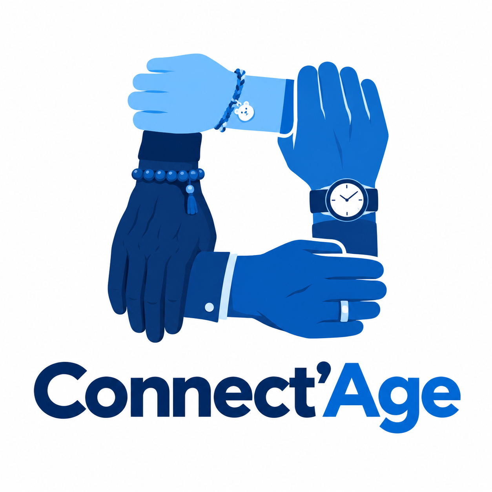

# Logo — Connect'Age

> Source : `logo.png`

- **Nom** : Connect'Age (« Connect » bleu marine, « 'Age » bleu vif)
- **Visuel** : quatre mains/avant-bras qui s'agrippent en carré, dans quatre nuances de bleu, chacune avec un accessoire (bracelet tressé à breloque ourson, montre, bague, bracelet de perles) — liens entre générations.
- **Palette** : bleu marine ≈ `#0B2A6B`, bleu vif ≈ `#1A6FE0`, bleu clair ≈ `#6DB8F5`, fond blanc.
